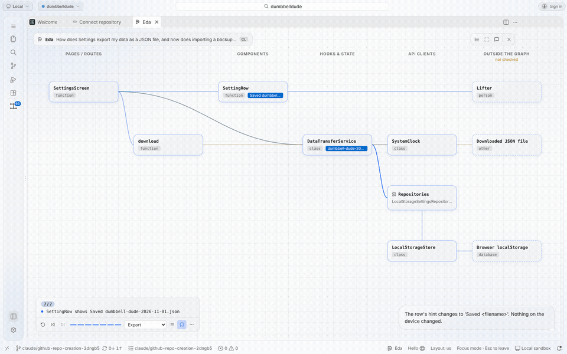
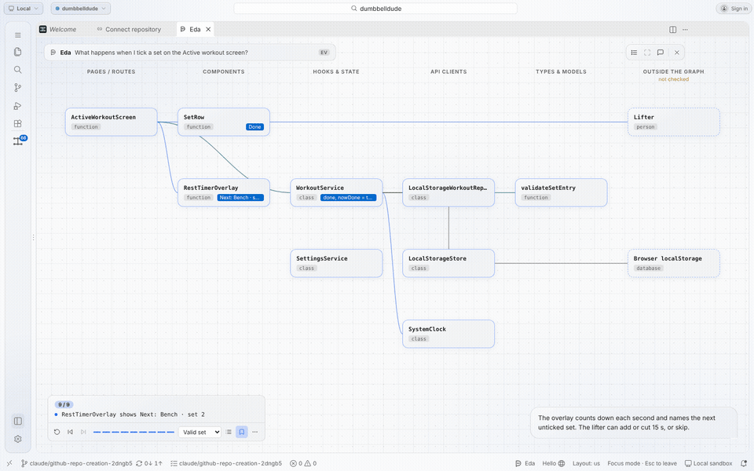
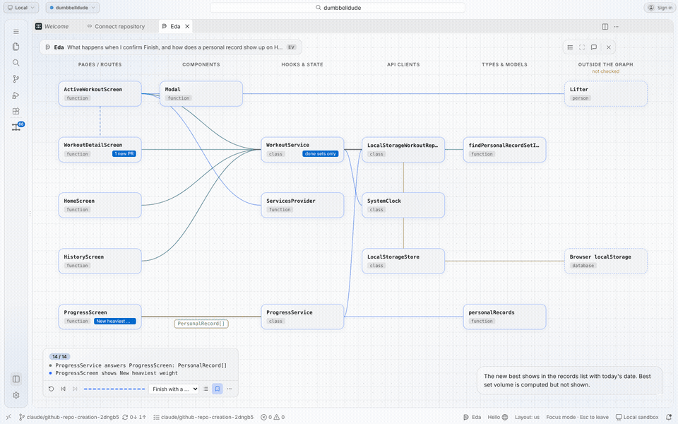
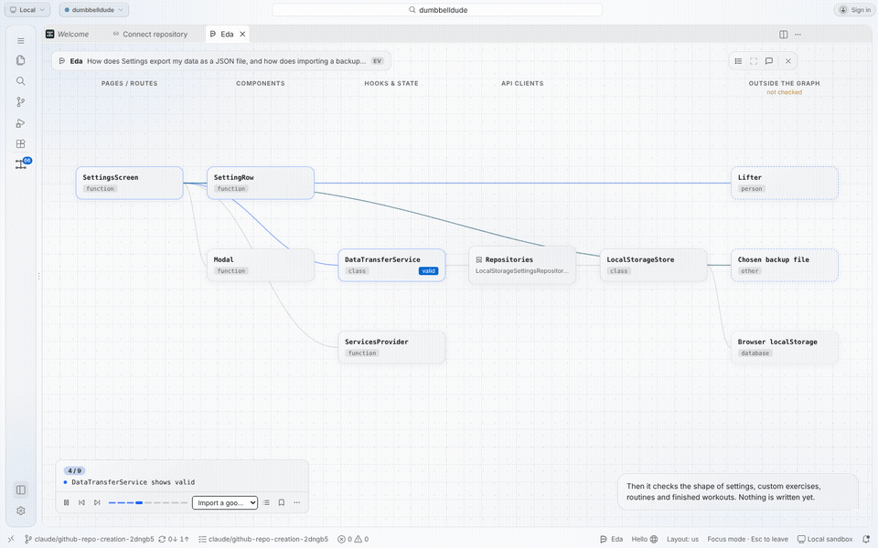

# Eda flow animations

Three Dumbbell Dude features, explained with Trussel's **Eda** flow tools on the IDE's local MCP server, and
recorded as they played in the Trussel IDE on 1 Nov 2026 (evening, IST).

**How they were made:**
1. An agent found the real actors with `search_nodes`, `get_module`, `trace` and `explain_connection`, and read the code
   for the order of calls.
2. It wrote one script per flow and sent it to `explain_flow`, which checks every actor against the analysed graph
   before it plays. The scripts are in [docs/flows/](../../flows/), with every step written out in plain words.
3. To record, each script was sent to `explain_flow` again through a direct MCP call. The IDE opened Focus mode and
   played the flow, and it was captured frame by frame at about 3.5 frames per second.

**Reading an animation:**
- **Columns:** the app's architecture columns (Pages / Routes, Components, Hooks & State, API clients, Types &
  Models), plus **Outside the graph** for the person, the browser's localStorage and files.
- **Movement:** each step moves a labelled packet along a real edge. The card that is active glows.
- **Captions:** the caption at the bottom right says what is happening, and the counter at the bottom left shows the
  step.

| # | Flow | Question it answers | Steps | Animation | Video | Key frame |
|---|---|---|---|---|---|---|
| 1 | Logging a set | What happens when I tick a set on the Active workout screen? | 9 of 9 | [GIF](1-logging-a-set.gif) | [MP4](1-logging-a-set.mp4) | [step 7](1-logging-a-set-step7.jpg) |
| 2 | Finishing a workout and earning a PR | What happens when I confirm Finish, and how does a PR show up on Home, History and Progress? | 14 of 14 | [GIF](2-finishing-a-workout.gif) | [MP4](2-finishing-a-workout.mp4) | [step 12](2-finishing-a-workout-step12.jpg) |
| 3a | Exporting data | How does Settings export my data as a JSON file? | 7 of 7 | [GIF](3-export-import.gif) | [MP4](3-export-import.mp4) | [step 7](3-export-step7.jpg) |
| 3b | Importing a good file (variant of 3) | How does importing a backup work? | 9 of 9 | [GIF](3b-import-good-file.gif) | [MP4](3b-import-good-file.mp4) | [mid-flow](3b-import-good-file-mid.jpg) |

Each flow also has a failure variant that wasn't recorded: an invalid set (6 steps), finishing with nothing ticked
(6 steps), and an invalid import file (6 steps). They're written out in [docs/flows/README.md](../../flows/README.md),
and they play from the variant picker in the IDE.

## 1. Logging a set

## 2. Finishing a workout and earning a PR

## 3a. Exporting data

## 3b. Importing a good file

## What Eda flagged and what got in the way

- **Flow 2, step 6:** `explain_flow` marked the step from the Active workout screen to the Workout detail screen as
  "not in the graph". That's accurate: the screen gets there through the router (`navigate('/history/:id')`), not a
  direct call.
- **Draft ids only:** `explain_flow` returned draft playback ids, not saved flow ids. Saving a flow appears to be a
  separate action in the IDE (the bookmark button), so `find_saved_flows` and `play_saved_flow` couldn't replay
  these by id. Recording meant sending each script again.
- **Stale analysis:** Trussel marked the analysis stale when the flows were written. Methods such as `toggleSetDone`
  exist in the graph only as design nodes, so the flows use the enclosing class or function as the actor.
- **Restart:** the cloud container restarted between the build and this step. The IDE had to be relaunched, the
  folder trusted again, and the window reloaded (review item F15) before the MCP server knew the repo again.
